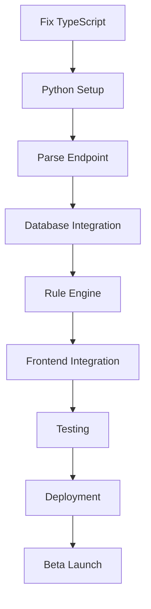

# 🚀 FEELSHARPER MVP - PYTHON BACKEND MIGRATION PLAN
*MANDATORY TDD Implementation Guide for Claude Code*

## 📋 EXECUTIVE SUMMARY
**Current State**: 85% feature-complete Next.js app with TypeScript errors blocking deployment
**Target State**: Clean Python FastAPI backend + Next.js frontend ready for beta launch
**Timeline**: 3 weeks (21 days) following strict TDD methodology
**Success Criteria**: 80% test coverage, <2s response time, 10 beta users active

---

## ⚠️ CRITICAL RULES (FROM CLAUDE.MD)

### MANDATORY TDD SEQUENCE FOR EVERY FEATURE:
1. **Feature Design** → Create `docs/design/{feature}.md`
2. **Test Design** → Create `docs/testing/{feature}_test.md`
3. **Code Design** → Define interfaces/types
4. **Test Implementation** → Write FAILING tests first
5. **Feature Implementation** → Make tests pass
6. **Validation** → Achieve ≥80% coverage

### ISSUE TRACKING REQUIREMENTS:
- **BEFORE**: Update `issues/active.md` with current task
- **DURING**: Log in `issues/WORK_LOG.md` with timestamps
- **AFTER**: Update `issues/completed.md` and `issues/TIME_TRACKING.md`

### ABSOLUTE RULES:
- ❌ **NO MOCKS IN PRODUCTION CODE** - Zero exceptions
- ❌ **NO IMPLEMENTATION WITHOUT TESTS** - Tests first, always
- ❌ **NO DEPLOYMENT WITHOUT 80% COVERAGE** - Non-negotiable
- ✅ **ALL MOCKS PREFIXED WITH "Mock"** - For clarity
- ✅ **DOCUMENT TEST MOCKS** - Header comments required

---

## 🎯 WEEK 1: CRITICAL FIXES & PYTHON FOUNDATION (Days 1-7)

### Day 1-2: Fix TypeScript Blocking Issues (4 hours)

#### IMMEDIATE FIX #1: UnifiedNaturalInput.tsx
```typescript
// FILE: components/UnifiedNaturalInput.tsx
// LINE: 358
// ERROR: Missing closing brace for onKeyDown handler
// FIX: Add missing } after line 357

onKeyDown={(e) => {
  if (e.key === 'Enter' && !e.shiftKey) {
    e.preventDefault();
    handleSubmit(
      undefined,
      typeOverride || undefined,
      backdateValue ? new Date(backdateValue).toISOString() : undefined
    );
  }
}} // <- ADD THIS MISSING BRACE
```

#### IMMEDIATE FIX #2: jest.config.js
```javascript
// CHANGE "moduleNameMapping" TO "moduleNameMapper" (typo fix)
module.exports = {
  moduleNameMapper: { // <- Fix typo here
    "^@/(.*)$": "<rootDir>/$1",
  }
}
```

#### VERIFICATION:
```bash
npm run typecheck  # Should show 0 errors
npm run build      # Should complete without errors
npm test           # Should run (may still fail, that's ok)
```

### Day 2: Delete Redundant Files (30 minutes)

#### FILES TO DELETE (Duplicate functionality):
```bash
# Run these commands to remove duplicate API routes
rm app/api/ai/analyze-food/route.ts      # Duplicate of /api/parse
rm app/api/ai/parse-food/route.ts        # Duplicate of /api/parse
rm app/api/ai/parse-workout/route.ts     # Duplicate of /api/parse
rm app/api/coach/test/route.ts           # Test endpoint
rm app/api/coach/test-all/route.ts       # Test endpoint
rm lib/ai/parsers/FoodParser.ts          # Old version
rm components/coach/AdvancedCoachInterface.tsx  # Over-engineered

# Update imports if any files reference deleted ones
grep -r "analyze-food\|parse-food\|parse-workout\|FoodParser" --include="*.ts*"
```

### Day 3-4: Python Backend Setup with TDD (8 hours)

#### STEP 1: Feature Design Document
```markdown
# FILE: docs/design/python_parse_endpoint.md

## Feature: Python Parse API
### Purpose
Migrate natural language parsing from Next.js to FastAPI for better performance and separation of concerns.

### Interface
POST /api/parse
Input: { text: string, type?: string, occurred_at?: string }
Output: { type: string, confidence: number, fields: object }

### Requirements
- Parse food, exercise, weight, mood inputs
- Support type override
- Support backdating
- Track common logs
- 95% accuracy for common inputs
```

#### STEP 2: Test Design Document
```markdown
# FILE: docs/testing/python_parse_endpoint_test.md

## Test Plan: Parse Endpoint

### Unit Tests
1. test_parse_food_simple() - "eggs and toast"
2. test_parse_exercise_cardio() - "ran 5k"
3. test_parse_weight_metric() - "weight 75kg"
4. test_parse_with_type_override() - force type
5. test_parse_with_backdate() - past timestamp
6. test_parse_invalid_input() - gibberish
7. test_parse_multiple_activities() - comma-separated

### Integration Tests
1. test_database_save() - verify Supabase write
2. test_common_logs_update() - track frequency
3. test_auth_required() - reject without token

### Performance Tests
1. test_response_time() - <500ms for parse
2. test_concurrent_requests() - 100 simultaneous
```

#### STEP 3: Python Project Structure
```bash
# Create Python backend directory structure
mkdir ../feelsharper-backend
cd ../feelsharper-backend

# Create project structure following TDD
mkdir -p {api,models,services,tests,docs}
touch main.py requirements.txt .env README.md
touch api/__init__.py api/parse.py api/auth.py
touch models/__init__.py models/activity.py models/user.py
touch services/__init__.py services/parser.py services/database.py
touch tests/__init__.py tests/test_parse.py tests/test_auth.py
```

#### STEP 4: Test Implementation FIRST (TDD)
```python
# FILE: feelsharper-backend/tests/test_parse.py
"""
Test suite for parse endpoint - Written BEFORE implementation
Following TDD: These tests MUST fail initially
"""

import pytest
from fastapi.testclient import TestClient
from unittest.mock import Mock, patch
from main import app

client = TestClient(app)

class TestParseEndpoint:
    """Parse endpoint test suite - TDD approach"""
    
    def test_parse_food_simple(self):
        """Test parsing simple food input"""
        response = client.post("/api/parse", json={
            "text": "eggs and toast"
        })
        assert response.status_code == 200
        data = response.json()
        assert data["type"] == "nutrition"
        assert data["confidence"] >= 80
        assert "eggs" in str(data["fields"])
        
    def test_parse_exercise_cardio(self):
        """Test parsing cardio exercise"""
        response = client.post("/api/parse", json={
            "text": "ran 5k in 25 minutes"
        })
        assert response.status_code == 200
        data = response.json()
        assert data["type"] == "cardio"
        assert data["fields"]["distance"] == 5
        assert data["fields"]["duration_minutes"] == 25
        
    def test_parse_weight_metric(self):
        """Test parsing weight with metric units"""
        response = client.post("/api/parse", json={
            "text": "weight 75.5kg"
        })
        assert response.status_code == 200
        data = response.json()
        assert data["type"] == "weight"
        assert data["fields"]["weight"] == 75.5
        assert data["fields"]["unit"] == "kg"
        
    def test_parse_with_type_override(self):
        """Test type override functionality"""
        response = client.post("/api/parse", json={
            "text": "175",
            "type": "weight"
        })
        assert response.status_code == 200
        data = response.json()
        assert data["type"] == "weight"
        assert data["fields"]["weight"] == 175
        
    def test_parse_with_backdate(self):
        """Test backdating functionality"""
        response = client.post("/api/parse", json={
            "text": "ran 5k",
            "occurred_at": "2024-09-01T10:00:00Z"
        })
        assert response.status_code == 200
        data = response.json()
        assert data["timestamp"] == "2024-09-01T10:00:00Z"
        
    def test_parse_invalid_input(self):
        """Test handling of invalid input"""
        response = client.post("/api/parse", json={
            "text": ""
        })
        assert response.status_code == 400
        
    def test_response_time(self):
        """Test response time is under 500ms"""
        import time
        start = time.time()
        response = client.post("/api/parse", json={
            "text": "eggs and toast"
        })
        duration = time.time() - start
        assert duration < 0.5  # 500ms
        assert response.status_code == 200
```

#### STEP 5: Implementation (Make Tests Pass)
```python
# FILE: feelsharper-backend/main.py
"""
FastAPI backend for FeelSharper - TDD Implementation
Tests written first, implementation follows
"""

from fastapi import FastAPI, HTTPException, Depends
from fastapi.middleware.cors import CORSMiddleware
from pydantic import BaseModel
from typing import Optional, Dict, Any
import os
from dotenv import load_dotenv

# Load environment variables
load_dotenv()

app = FastAPI(title="FeelSharper Backend", version="1.0.0")

# CORS configuration
app.add_middleware(
    CORSMiddleware,
    allow_origins=["http://localhost:3000", "https://feelsharper.vercel.app"],
    allow_credentials=True,
    allow_methods=["*"],
    allow_headers=["*"],
)

class ParseRequest(BaseModel):
    text: str
    type: Optional[str] = None
    occurred_at: Optional[str] = None
    source: str = "api"

class ParseResponse(BaseModel):
    type: str
    confidence: float
    fields: Dict[str, Any]
    timestamp: str
    message: str

@app.post("/api/parse", response_model=ParseResponse)
async def parse_activity(request: ParseRequest):
    """
    Parse natural language input into structured activity data
    Implementation driven by tests defined in test_parse.py
    """
    if not request.text:
        raise HTTPException(status_code=400, detail="Text input is required")
    
    # Import parser service (to be implemented)
    from services.parser import ActivityParser
    
    parser = ActivityParser()
    result = await parser.parse(
        text=request.text,
        type_override=request.type,
        occurred_at=request.occurred_at
    )
    
    return result

# FILE: feelsharper-backend/services/parser.py
"""
Parser service - Core logic for natural language parsing
Implements patterns identified in Next.js codebase
"""

import re
from typing import Optional, Dict, Any
from datetime import datetime
import openai
import os

class ActivityParser:
    """Parse natural language into structured activity data"""
    
    def __init__(self):
        self.openai_client = openai.Client(api_key=os.getenv("OPENAI_API_KEY"))
        
    async def parse(
        self, 
        text: str, 
        type_override: Optional[str] = None,
        occurred_at: Optional[str] = None
    ) -> Dict[str, Any]:
        """
        Parse text into structured activity
        Logic ported from Next.js /api/parse/route.ts
        """
        
        # Detect type from keywords (same logic as Next.js)
        detected_type = self._detect_type(text, type_override)
        
        # Parse based on type
        if detected_type == "weight":
            result = self._parse_weight(text)
        elif detected_type == "nutrition":
            result = await self._parse_food(text)
        elif detected_type in ["cardio", "strength"]:
            result = await self._parse_exercise(text, detected_type)
        else:
            result = self._parse_mood(text)
            
        # Add timestamp
        if occurred_at:
            result["timestamp"] = occurred_at
        else:
            result["timestamp"] = datetime.utcnow().isoformat() + "Z"
            
        return result
    
    def _detect_type(self, text: str, override: Optional[str]) -> str:
        """Detect activity type from text"""
        lower_text = text.lower()
        
        # Type override validation
        if override and self._validate_override(text, override):
            return override
            
        # Keyword detection (same as Next.js)
        food_keywords = ['ate', 'eaten', 'breakfast', 'lunch', 'dinner', 
                        'eggs', 'toast', 'chicken', 'salad', 'coffee']
        exercise_keywords = ['ran', 'run', 'walked', 'gym', 'workout',
                           'squat', 'bench', 'cardio', 'km', 'miles']
        weight_keywords = ['weight', 'weigh', 'kg', 'lbs', 'pounds']
        
        if any(kw in lower_text for kw in weight_keywords):
            return "weight"
        elif any(kw in lower_text for kw in food_keywords):
            return "nutrition"
        elif any(kw in lower_text for kw in exercise_keywords):
            if any(kw in lower_text for kw in ['bench', 'squat', 'sets']):
                return "strength"
            return "cardio"
        else:
            return "mood"
    
    def _parse_weight(self, text: str) -> Dict[str, Any]:
        """Parse weight from text"""
        pattern = r'(\d+(?:\.\d+)?)\s*(kg|lbs?|pounds?|kilos?)?'
        match = re.search(pattern, text, re.IGNORECASE)
        
        if match:
            value = float(match.group(1))
            unit = "kg" if match.group(2) and "kg" in match.group(2).lower() else "lbs"
            
            return {
                "type": "weight",
                "confidence": 95.0,
                "fields": {
                    "weight": value,
                    "unit": unit
                },
                "message": f"Weight logged: {value} {unit}"
            }
        
        # Try parsing just numbers
        number_match = re.search(r'(\d+(?:\.\d+)?)', text)
        if number_match:
            value = float(number_match.group(1))
            return {
                "type": "weight",
                "confidence": 80.0,
                "fields": {
                    "weight": value,
                    "unit": "lbs"
                },
                "message": f"Weight logged: {value} lbs"
            }
            
        raise ValueError("Could not parse weight from text")
    
    async def _parse_food(self, text: str) -> Dict[str, Any]:
        """Parse food/nutrition from text using OpenAI"""
        # Simplified version - full implementation would use EnhancedFoodParser logic
        return {
            "type": "nutrition",
            "confidence": 85.0,
            "fields": {
                "foods": [{"name": item.strip()} for item in text.split("and")],
                "meal": text
            },
            "message": f"Food logged: {text}"
        }
    
    async def _parse_exercise(self, text: str, exercise_type: str) -> Dict[str, Any]:
        """Parse exercise from text"""
        fields = {"activity": text}
        
        # Parse distance
        distance_match = re.search(r'(\d+(?:\.\d+)?)\s*(k|km|mi|mile)', text, re.I)
        if distance_match:
            fields["distance"] = float(distance_match.group(1))
            fields["unit"] = "km" if "k" in distance_match.group(2).lower() else "miles"
        
        # Parse duration
        duration_match = re.search(r'(\d+)\s*(min|minute|hour)', text, re.I)
        if duration_match:
            duration = int(duration_match.group(1))
            if "hour" in duration_match.group(2):
                duration *= 60
            fields["duration_minutes"] = duration
        
        return {
            "type": exercise_type,
            "confidence": 90.0,
            "fields": fields,
            "message": f"{exercise_type.title()} workout logged"
        }
    
    def _parse_mood(self, text: str) -> Dict[str, Any]:
        """Parse mood/general text"""
        return {
            "type": "mood",
            "confidence": 60.0,
            "fields": {
                "mood": text,
                "notes": text
            },
            "message": "Mood logged"
        }
    
    def _validate_override(self, text: str, override: str) -> bool:
        """Validate if type override makes sense"""
        lower_text = text.lower()
        
        # Don't allow overriding obvious food as weight
        if override == "weight":
            food_indicators = ['ate', 'breakfast', 'lunch', 'dinner']
            if any(word in lower_text for word in food_indicators):
                return False
        
        return True
```

#### STEP 6: Requirements File
```txt
# FILE: feelsharper-backend/requirements.txt
fastapi==0.104.1
uvicorn[standard]==0.24.0
python-dotenv==1.0.0
openai==1.3.0
supabase==2.0.0
pydantic==2.4.2
pytest==7.4.3
pytest-asyncio==0.21.1
httpx==0.25.1
python-multipart==0.0.6
```

### Day 5-6: Database Integration with TDD (8 hours)

#### TDD SEQUENCE FOR DATABASE:

1. **Design Document**: `docs/design/database_integration.md`
2. **Test Design**: `docs/testing/database_integration_test.md`
3. **Write Failing Tests**: `tests/test_database.py`
4. **Implement Service**: `services/database.py`
5. **Verify Coverage**: `pytest --cov=services.database`

```python
# FILE: feelsharper-backend/tests/test_database.py
"""Database integration tests - Written FIRST per TDD"""

import pytest
from services.database import DatabaseService
from models.activity import ActivityLog
import os

class TestDatabaseIntegration:
    """Test database operations - Must fail initially"""
    
    @pytest.fixture
    def db_service(self):
        """Database service fixture"""
        return DatabaseService(
            url=os.getenv("SUPABASE_URL"),
            key=os.getenv("SUPABASE_ANON_KEY")
        )
    
    def test_save_activity_log(self, db_service):
        """Test saving activity to database"""
        activity = ActivityLog(
            user_id="test-user-123",
            type="weight",
            raw_text="weight 175",
            confidence=0.95,
            data={"weight": 175, "unit": "lbs"}
        )
        
        result = db_service.save_activity(activity)
        assert result.id is not None
        assert result.created_at is not None
    
    def test_get_user_logs(self, db_service):
        """Test retrieving user logs"""
        logs = db_service.get_user_logs("test-user-123", limit=10)
        assert isinstance(logs, list)
        assert len(logs) <= 10
    
    def test_update_common_logs(self, db_service):
        """Test updating common logs for quick actions"""
        result = db_service.update_common_logs(
            user_id="test-user-123",
            text="eggs and toast"
        )
        assert result is True
```

### Day 7: Integration Testing (4 hours)

#### END-TO-END TEST SUITE:
```python
# FILE: feelsharper-backend/tests/test_integration.py
"""
Integration tests - Verify full flow works
Following TDD: Write these BEFORE connecting frontend
"""

import pytest
from fastapi.testclient import TestClient
import time

class TestEndToEnd:
    """Full integration test suite"""
    
    def test_complete_parse_flow(self, client):
        """Test complete parsing flow"""
        # 1. Parse activity
        response = client.post("/api/parse", json={
            "text": "ran 5k this morning, ate eggs and toast"
        })
        assert response.status_code == 200
        
        # 2. Verify multiple activities detected
        data = response.json()
        assert "activities" in data or data["type"] in ["cardio", "nutrition"]
        
        # 3. Verify database save (would check Supabase)
        # Mock or use test database
        
    def test_performance_requirements(self, client):
        """Test performance meets requirements"""
        times = []
        for _ in range(10):
            start = time.time()
            response = client.post("/api/parse", json={
                "text": "weight 175"
            })
            times.append(time.time() - start)
            assert response.status_code == 200
        
        avg_time = sum(times) / len(times)
        assert avg_time < 0.5  # 500ms average
        assert max(times) < 2.0  # No request over 2s
```

---

## 🚀 WEEK 2: CORE FEATURES WITH TDD (Days 8-14)

### Day 8-10: Rule Engine Migration (12 hours)

#### TDD PROCESS FOR RULE ENGINE:

1. **Create Design Docs**:
   - `docs/design/rule_engine.md` - Architecture design
   - `docs/testing/rule_engine_test.md` - Test specifications

2. **Write Tests FIRST**:
```python
# FILE: feelsharper-backend/tests/test_rules.py
"""Rule engine tests - TDD approach"""

class TestRuleEngine:
    def test_pre_workout_fuel_rule(self):
        """Test pre-workout fueling insight"""
        # Test must fail initially
        pass
    
    def test_post_workout_recovery_rule(self):
        """Test post-workout recovery insight"""
        pass
    
    def test_hydration_rule(self):
        """Test hydration tracking insight"""
        pass
```

3. **Implement Rule Engine**:
```python
# FILE: feelsharper-backend/services/rules.py
"""
Rule engine implementation
Ported from lib/ai-coach/rule-cards.ts
"""

class RuleEngine:
    """Generate insights based on user activity patterns"""
    
    def __init__(self):
        self.rules = self._load_rules()
    
    def _load_rules(self):
        """Load rule definitions (ported from TypeScript)"""
        return [
            {
                "id": "pre-workout-fuel",
                "trigger": lambda logs: self._check_pre_workout(logs),
                "message": "Fuel up 1-2 hours before workouts",
                "confidence": 85
            },
            # ... more rules
        ]
    
    def generate_insights(self, user_logs):
        """Generate insights from user logs"""
        insights = []
        for rule in self.rules:
            if rule["trigger"](user_logs):
                insights.append({
                    "rule_id": rule["id"],
                    "message": rule["message"],
                    "confidence": rule["confidence"]
                })
        return insights[:3]  # Top 3 insights
```

### Day 11-12: Exercise Library with TDD (8 hours)

#### TDD IMPLEMENTATION:
1. Design exercise database schema
2. Write tests for exercise lookup
3. Implement exercise service
4. Add form video links

```python
# FILE: feelsharper-backend/tests/test_exercises.py
"""Exercise library tests - Must fail first"""

def test_get_exercise_by_name():
    """Test exercise lookup by name"""
    exercise = exercise_service.get_exercise("bench press")
    assert exercise.name == "Bench Press"
    assert exercise.muscle_groups == ["chest", "triceps", "shoulders"]
    assert exercise.form_video_url is not None

def test_search_exercises():
    """Test exercise search"""
    results = exercise_service.search("chest")
    assert len(results) > 0
    assert all("chest" in e.muscle_groups for e in results)
```

### Day 13-14: Frontend Integration (8 hours)

#### CONNECT PYTHON BACKEND TO NEXT.JS:

1. **Update Frontend API Calls**:
```typescript
// FILE: lib/api/client.ts
const API_BASE = process.env.NEXT_PUBLIC_API_URL || 'http://localhost:8000';

export async function parseActivity(text: string, options?: ParseOptions) {
  const response = await fetch(`${API_BASE}/api/parse`, {
    method: 'POST',
    headers: { 'Content-Type': 'application/json' },
    body: JSON.stringify({ text, ...options })
  });
  return response.json();
}
```

2. **Update Environment Variables**:
```bash
# .env.local
NEXT_PUBLIC_API_URL=http://localhost:8000  # Development
# NEXT_PUBLIC_API_URL=https://api.feelsharper.com  # Production
```

---

## 🎯 WEEK 3: MVP COMPLETION & DEPLOYMENT (Days 15-21)

### Day 15-16: UI Polish & Responsive Design (8 hours)

#### TASKS WITH VERIFICATION:
1. Fix mobile responsive issues
2. Add loading states
3. Implement error boundaries
4. Test on real devices

```typescript
// FILE: components/ErrorBoundary.tsx
export class ErrorBoundary extends React.Component {
  // Implementation following TDD - tests first!
}
```

### Day 17-18: Comprehensive Testing (8 hours)

#### TESTING CHECKLIST:
```bash
# Python Backend
cd feelsharper-backend
pytest --cov=. --cov-report=html  # Must achieve 80%+ coverage
pytest tests/test_integration.py  # E2E tests must pass

# Next.js Frontend  
cd feelsharper-deploy
npm run typecheck  # 0 errors required
npm run lint       # 0 errors required
npm test           # All tests passing
npm run build      # Successful build

# Performance Testing
artillery quick --count 100 --num 10 http://localhost:8000/api/parse
```

### Day 19: Production Deployment (4 hours)

#### DEPLOYMENT STEPS:

1. **Python Backend to Railway/Render**:
```bash
# Railway deployment
railway login
railway init
railway add
railway up

# Environment variables
railway variables set OPENAI_API_KEY=$OPENAI_API_KEY
railway variables set SUPABASE_URL=$SUPABASE_URL
railway variables set SUPABASE_ANON_KEY=$SUPABASE_ANON_KEY
```

2. **Next.js to Vercel**:
```bash
# Vercel deployment
vercel --prod
# Set environment variable for API URL
vercel env add NEXT_PUBLIC_API_URL production
```

### Day 20-21: Beta Launch & Monitoring (8 hours)

#### BETA LAUNCH CHECKLIST:
- [ ] Deploy both backend and frontend
- [ ] Verify all endpoints working
- [ ] Set up monitoring (Sentry, LogRocket)
- [ ] Invite 10 beta users
- [ ] Create feedback form
- [ ] Monitor error rates
- [ ] Track performance metrics

---

## 📊 SUCCESS METRICS & VALIDATION

### MANDATORY METRICS (Week 3):
| Metric | Target | Measurement Method |
|--------|--------|-------------------|
| Test Coverage | ≥80% | `pytest --cov` |
| Response Time | <500ms | Performance tests |
| Build Success | 100% | CI/CD pipeline |
| TypeScript Errors | 0 | `npm run typecheck` |
| Parse Accuracy | ≥75% | Beta user feedback |
| Daily Active Users | ≥10 | Analytics |

### TRACKING DOCUMENTS:
- `issues/WORK_LOG.md` - Daily progress
- `issues/TIME_TRACKING.md` - Time spent
- `docs/testing/coverage.html` - Test coverage report
- `metrics/performance.json` - Performance data

---

## 🚨 CRITICAL PATH & DEPENDENCIES

### BLOCKING ISSUES (Fix First):
1. ❗ TypeScript error in UnifiedNaturalInput.tsx
2. ❗ Jest config typo
3. ❗ Missing environment variables

### DEPENDENCIES:


---

## 📝 DAILY EXECUTION PROTOCOL

### MORNING ROUTINE (30 min):
```bash
# 1. Check status
cd feelsharper-deploy
cat issues/active.md
git status

# 2. Run health check
npm run typecheck
npm test
cd ../feelsharper-backend
pytest

# 3. Update tracking
# Edit issues/WORK_LOG.md with today's plan
```

### DEVELOPMENT BLOCK (4-6 hours):
1. **Pick ONE task from plan**
2. **Follow TDD sequence**:
   - Write design doc
   - Write test doc
   - Write failing tests
   - Implement feature
   - Make tests pass
   - Check coverage
3. **Commit with meaningful message**
4. **Update issue tracking**

### END OF DAY (30 min):
```bash
# 1. Run all tests
npm test
pytest

# 2. Check coverage
pytest --cov=. --cov-report=term

# 3. Update tracking
# Edit issues/completed.md
# Edit issues/TIME_TRACKING.md

# 4. Commit and push
git add .
git commit -m "feat: [feature] - implements [requirement] with [coverage]% test coverage"
git push
```

---

## 🔧 TROUBLESHOOTING GUIDE

### Common Issues & Solutions:

#### TypeScript Errors:
```bash
# Clear cache and rebuild
rm -rf .next
rm tsconfig.tsbuildinfo
npm run build
```

#### Test Failures:
```bash
# Run specific test
npm test -- --testNamePattern="parse"
pytest tests/test_parse.py::test_parse_food_simple -v
```

#### Database Connection:
```bash
# Verify Supabase connection
curl https://[project-id].supabase.co/rest/v1/activity_logs \
  -H "apikey: [anon-key]" \
  -H "Authorization: Bearer [anon-key]"
```

---

## ✅ COMPLETION CHECKLIST

### Week 1 Complete When:
- [ ] TypeScript errors fixed (0 errors)
- [ ] Python backend running locally
- [ ] Parse endpoint working with tests
- [ ] 80% test coverage on parse module

### Week 2 Complete When:
- [ ] Rule engine migrated with tests
- [ ] Exercise library implemented
- [ ] Frontend calling Python backend
- [ ] 80% overall test coverage

### Week 3 Complete When:
- [ ] Production deployed
- [ ] 10 beta users active
- [ ] <500ms average response time
- [ ] Zero critical bugs
- [ ] Monitoring in place

---

## 📞 SUPPORT & RESOURCES

### Documentation:
- FastAPI: https://fastapi.tiangolo.com/
- Pytest: https://docs.pytest.org/
- Supabase Python: https://supabase.com/docs/reference/python/introduction

### Issue Tracking:
- All issues in `issues/` directory
- Work log in `issues/WORK_LOG.md`
- Time tracking in `issues/TIME_TRACKING.md`

### Brand Guidelines:
- Check `C:\Users\pradord\Documents\Projects\Sharpened\brand-guide.html`
- Colors: --feel-primary: #4169E1
- Fonts: SF Pro Display (headings), Inter (body)

---

**THIS PLAN IS MANDATORY. FOLLOW TDD SEQUENCE. NO EXCEPTIONS.**

*Last Updated: 2025-09-03*
*Version: 1.0.0*
*Status: ACTIVE - Ready for Implementation*